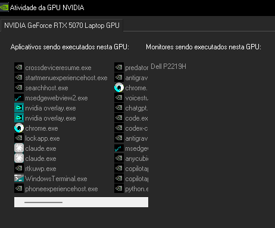

# Vitals

HUD local de saúde de servidor Windows: CPU, memória, **GPU** e, principalmente,
**quem está consumindo** — com ejeção segura de processos e workloads.

Feito para uma máquina que roda ComfyUI, LM Studio e um pipeline de TTS
(Morpheus/OpenJarvis → Kokoro + Chatterbox) e vive perto do limite de RAM e
VRAM. O objetivo não é ser um Task Manager bonito: é responder rápido
"o que está apertando a máquina e como eu paro isso sem derrubar o resto?"



## Estado atual

- Electron + Vite + React no renderer, motor de telemetria em Node puro.
- Sensor PowerShell 7 (`windows-sensor.ps1`) para processos, GPU por processo,
  VRAM por adaptador, commit charge e portas.
- `nvidia-smi` como telemetria complementar do adaptador NVIDIA.
- Workloads agrupados por árvore de processos + regras (`ComfyUI`, `LM Studio`,
  `Morpheus / TTS`, `OpenCode`, navegadores, terminais).
- Ejeção graciosa com escalonamento explícito para força, política de proteção
  e auditoria em JSONL.
- API HTTP local (REST + SSE) para agentes e para a UI em modo navegador.
- 40 testes cobrindo invariantes de segurança, agrupamento e parsing.

## Requisitos

- Windows 10/11 x64.
- Node.js >= 22.12.
- PowerShell 7 (`pwsh`) no PATH — o sensor é um script `.ps1`.
- Opcional: `nvidia-smi` para temperatura, potência, clocks e fan.

## Começar

```powershell
npm install
npm run doctor      # checa pwsh, contadores, nvidia-smi e porta 4780
npm run dev         # app Electron com HMR
```

Ou, no Explorer, dê duplo clique em **`Vitals.bat`**: ele instala as
dependências e compila na primeira vez, depois só abre o app. Use
`Vitals.bat --rebuild` para forçar o build e `Vitals.bat --dev` para HMR.

Para gerar um **executável portátil** (não exige Node no destino):

```powershell
npm run dist
# saída: dist\Vitals-0.1.0-portatil.exe  (~106 MB, arquivo único)
```

O `.env`, se existir ao lado do `.exe`, é lido automaticamente. O binário não
é assinado; o Windows pode mostrar o aviso do SmartScreen na primeira execução.

Sem abrir janela (útil para agente ou máquina remota):

```powershell
npm run probe              # um snapshot resumido no terminal
npm run probe:serve        # UI em http://127.0.0.1:4780 + API + SSE
npx tsx scripts/probe.ts --json   # snapshot completo, JSON puro (sem log)
```

> Use `npx tsx scripts/probe.ts --json` para consumo por máquina. `npm run
> probe -- --json` injeta o banner do npm no stdout e quebra o parse.

## Comandos

| Comando | O que faz |
| --- | --- |
| `Vitals.bat` | Abre o app (instala/compila se preciso) |
| `Vitals.bat --rebuild` | Força `npm run build` antes de abrir |
| `Vitals.bat --dev` | Abre em modo desenvolvimento (HMR) |
| `npm run dist` | Gera `dist\Vitals-<versao>-portatil.exe` |
| `npm run dist:dir` | Gera `dist\win-unpacked\Vitals.exe` (sem empacotar) |
| `npm run dev` | Electron + renderer em modo desenvolvimento |
| `npm run build` | Compila main/preload/renderer e copia o sensor para `out/main` |
| `npm start` | Preview do build (`electron-vite preview`) |
| `npm run typecheck` | Typecheck de Node e do renderer |
| `npm test` | Vitest (40 testes) |
| `npm run doctor` | Diagnóstico do ambiente e das fontes |
| `npm run probe` | Snapshot resumido e sai |
| `npm run probe:serve` | API + UI em `127.0.0.1:4780` |
| `npx tsx scripts/probe.ts --json` | Snapshot completo em JSON |

## Configuração

Copie `.env.example` para `.env`. Os principais:

| Variável | Padrão | Efeito |
| --- | --- | --- |
| `VITALS_SAMPLE_MS` | `1500` | Intervalo de amostragem (500–10000) |
| `VITALS_HISTORY_POINTS` | `120` | Pontos de histórico em memória |
| `VITALS_HTTP` / `VITALS_HTTP_PORT` | `1` / `4780` | API local e UI servida |
| `VITALS_ACTIONS` | `1` | Habilita ejeção na UI |
| `VITALS_GRACEFUL_TIMEOUT_MS` | `3000` | Espera antes de sugerir "forçar" |
| `VITALS_PORTS_MS` | `10000` | Intervalo do `netstat` |
| `VITALS_LOG_DIR` | `%APPDATA%\Vitals\logs` | Logs e auditoria |
| `VITALS_HTTP_TOKEN` | vazio | Token (>= 16 chars) para ações via HTTP |
| `VITALS_REMOTE_ACTIONS` | `0` | Liga `POST /api/terminate` (exige token) |

## Segurança em uma tela

- Nada é encerrado sem passar por `src/main/actions/policy.ts`.
- Protegidos: kernel, serviços, Defender, `explorer`, `dwm` e o próprio Vitals
  (incluindo o processo do sensor).
- Gracioso primeiro (`taskkill /PID`, sem `/F`). Força só quando pedido.
- PID reciclado é bloqueado por `expectedStartedAt`.
- Toda tentativa — inclusive bloqueada — vai para `audit.jsonl`.
- A API escuta só em `127.0.0.1`; ações remotas exigem token **e** flag.

Detalhes em [docs/SECURITY.md](docs/SECURITY.md).

## Estrutura

```
src/
  main/            processo principal Electron, motor, fontes, ações, HTTP
    telemetry/
      sources/     windows-sensor (ps1 + ts), nvidia-smi, netstat, storage
    actions/       policy, terminate, audit
    http/          REST + SSE + estáticos
  preload/         ponte IPC segura
  renderer/        React (UI)
  shared/          contratos, tipos, formatação, regras de workload
scripts/           probe, doctor, copy-assets
tests/             invariantes e fixtures
docs/              arquitetura, contratos, operação, ADRs
```

## Documentação

| Documento | Para quê |
| --- | --- |
| [AGENTS.md](AGENTS.md) | Regras para agentes que continuam o projeto |
| [docs/ARCHITECTURE.md](docs/ARCHITECTURE.md) | Como o motor, o sensor e a UI se encaixam |
| [docs/CONTRACTS.md](docs/CONTRACTS.md) | Schema 2, API HTTP, SSE, auditoria |
| [docs/DATA-SOURCES.md](docs/DATA-SOURCES.md) | Cada fonte, contador e armadilha |
| [docs/OPERATIONS.md](docs/OPERATIONS.md) | Rodar, diagnosticar, interpretar |
| [docs/SECURITY.md](docs/SECURITY.md) | Modelo de ameaça e ejeção |
| [docs/ROADMAP.md](docs/ROADMAP.md) | O que falta |
| [docs/WORKLOG.md](docs/WORKLOG.md) | Diário técnico das sessões |
| [docs/adr/](docs/adr/) | Decisões arquiteturais |

## Licença

UNLICENSED — uso interno.
